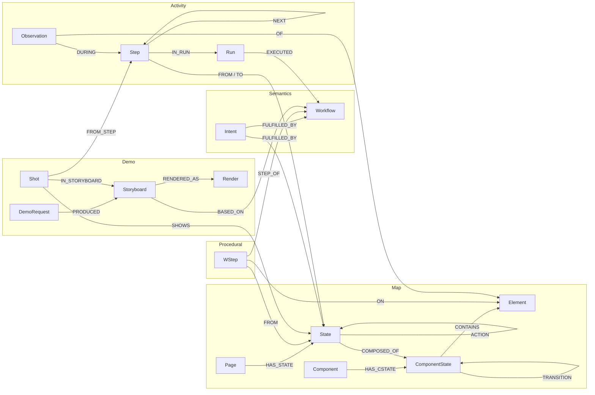

# SiteGraph

SiteGraph is a Python agent system that explores a public website into a **FalkorDB graph**, then uses graph algorithms to plan routes, recommend automations, run them (and keep them working when the UI changes), and turn paths in the graph into demos (video, GIF, screenshot, step guide, click-through).

**Hackathon tracks:** T1 *Agents That Act on Connected Data* (primary) and T2 *Agent Memory & Coordination* (coordination is real: shared work items, claims and tasks in a graph; long-term memory is only partly built, see [Known limits](#known-limits)).

> **Status:** the engine, graph, command line, LLM agents and MCP server are built. The web API and web UI (plan tasks 18-19) are **not built**; use the command line below. The agent layer has so far been exercised with scripted models only, not a live LLM (see [Known limits](#known-limits)).

## Demo video

_To be recorded._

## Quick start

Requires Docker, Python 3.11 and [uv](https://docs.astral.sh/uv/).

```bash
docker compose up -d                      # FalkorDB on localhost:6379 (data persisted in ./data/falkordb)
uv venv --python 3.11 .venv && source .venv/bin/activate     # Windows Git Bash: . .venv/Scripts/activate
uv pip install -e ".[dev]"
python -m playwright install chromium

# Optional: a model for summaries, intents, captions and request routing (any OpenAI-compatible API)
export LLM_MODEL=openai/gpt-4o-mini LLM_API_KEY=...        # add LLM_API_BASE=... for a local server

python -m sitegraph run https://books.toscrape.com/ "explore the site" "open the travel category" "make a gif of the menu"
```

For a conversation instead of a fixed list of requests, use the chat agent (needs an LLM with tool calling and vision; without one it falls back to the fixed request pipeline):

```bash
python -m sitegraph chat https://books.toscrape.com/     # then type: "take me to the mystery category", "make a gif of the menu", ...
```

The agent uses the same engine through tools (find a screen, plan and run a route, observe/click/hover/fill, explore with several browsers, make a demo, remember a preference). **Risky actions (checkout, delete, posting, links to other sites) are refused by the tools until you answer `y` at the terminal prompt**, and that approval covers that one action only. Page text is shown to the model as untrusted data, and what you type into a form is scrubbed from what is stored. See [Agents and tools](#agents-and-tools).

To use the same tools from an MCP client (Claude Desktop, Claude Code, ...) instead of the built-in chat, run the server over stdio, for example in the client's MCP config:

```json
{ "mcpServers": { "sitegraph": { "command": "python", "args": ["-m", "sitegraph", "mcp", "https://books.toscrape.com/"] } } }
```

Risky actions are then approved through the client's own prompt (MCP elicitation); a client that cannot ask simply gets the refusal.

With `run`, each quoted request is run in order against the same site graph. What the agent does depends on the wording:

| Say something like | It does |
|---|---|
| "explore the site" | launches several Navigators in parallel (`--navigators N`, default `navigators_per_site: 2` in `config.yaml`) that map the site, then the Curator annotates it and runs the graph algorithms |
| "open the cart", "take me to X" | finds the matching screen by meaning, plans a risk-capped route, executes it in a real browser, and heals broken locators |
| "make a gif / video / guide / click-through / screenshot of ..." | interprets the request, builds a storyboard from graph paths, records it and renders the files |
| "what should I automate?" | prints next actions, frontier, suggested workflows and demo candidates |
| "save this as a workflow" | stores the last successful run as a reusable workflow |

Without `LLM_API_KEY` the system still runs with built-in fallbacks (keyword routing, title-based summaries, plain captions). Embeddings use `BAAI/bge-small-en-v1.5` (downloaded once, ~130 MB); `--embedder hash` is an offline, much weaker stand-in for quick tests. Results are printed as JSON, and rendered files go to `data/blobs/`.

Config lives in `config.yaml` (environment variables `LLM_MODEL`, `LLM_API_BASE`, `LLM_API_KEY`, `SITEGRAPH_*` override it).

## Graph data model

One FalkorDB graph per **user x site x device** holds everything that must be traversed together; separate graphs exist only for isolation.

```
FalkorDB instance
 u:{uid}:site:{domain}:{device}   DEVICE GRAPH   map + semantics + workflows + runs + demos
 u:{uid}:ops:{domain}             OPS GRAPH      agents, tasks, claims, shared exploration work items
 u:{uid}:profile                  PROFILE GRAPH  preferences, policies, sessions, memory, site index
```

Key design rules: edges are actions and paths are plans; anything an algorithm must include or exclude is a **label or relationship type** (algorithms cannot filter by property); every node has a deterministic content hash `gid` (same screen found twice = same node, merges are idempotent); precomputed algorithm scores sit on nodes so an agent reads them cheaply; typed input values are never stored.



### Device graph nodes

| Label | Key properties | Purpose |
|---|---|---|
| `Page` | `url_template`, `example_urls`, `title` | where am I (e.g. `/product.html?id`) |
| `State` (+ `:Entry`, `:Frontier`, `:Blocking`) | `tokens`, `aliases`, `summary`, `emb`, `untried_count`, `pagerank`, `betweenness`, `community`, `demo_score` | the node the planner moves between |
| `Component` / `ComponentState` | `kind`, `blocking`, `ephemeral`; `name` (e.g. closed/open), `aria_state` | reusable region and its small states (a menu open vs closed) without multiplying States |
| `Element` (+ template data) | `role`, `name_sample`, `name_norm`, `locators[]`, `fingerprint`, `risk`, `risk_cost`, `tried`, `volatile`, `is_template`, `count` | the thing you click; multi-locator list and fingerprint give runtime healing |
| `Intent`, `Feature` | `text`/`name`, `emb` | natural-language goals; communities of states for coverage |
| `Workflow`, `WStep` | `name`, `params`, `run_count`, `success_rate`, `demo_score`; `order`, `action_gid`, `value_var` | reusable parameterised automations |
| `Run`, `Step`, `Observation` | `kind`, `status`; `ok`, `healed`, `latency_ms`; `kind` (heal, unexpected_state) | append-only activity log (last 100 runs kept in full) |
| `DemoRequest`, `Storyboard`, `Shot`, `Render` | request text and interpretation; captions; blob refs | demo provenance, from request to file |

### Device graph edges

| Edge | From -> To | Used by |
|---|---|---|
| **`ACTION`** | State -> State | routing (`algo.SPpaths`), next-action, frontier BFS, PageRank / betweenness / label propagation. Properties: `action_type`, `el_gid`, `pre_cstates`, `requires_inputs`, `risk_cost`, `seen_count`, `success_count`, `reliability`, `cost` |
| **`TRANSITION`** | ComponentState -> ComponentState | menus/dialogs opening (by click **or hover**); satisfies `pre_cstates` |
| `HAS_STATE`, `COMPOSED_OF`, `HAS_CSTATE`, `CONTAINS` | containment | ownership (`HAS_*`), shared membership (`COMPOSED_OF`), visibility (`CONTAINS`) |
| `FULFILLED_BY` | Intent -> State / Workflow | request-to-goal lookup |
| `STEP_OF`, `FROM`, `ON` | WStep -> ... | workflows, impact analysis, demo scoring |
| `IN_RUN`, `NEXT`, `FROM` / `TO`, `EXECUTED`, `DURING`, `OF` | activity | workflow mining, retention, drift and heal evidence |
| `PRODUCED`, `BASED_ON`, `IN_STORYBOARD`, `SHOWS`, `FROM_STEP`, `RENDERED_AS` | demo layer | provenance, re-rendering |

### Ops and profile graphs

| Graph | Label | Holds |
|---|---|---|
| ops | `Agent`, `Task`, `Claim` | registry, work queue per request, leases (`HELD_BY`) |
| ops | `WorkItem` | shared exploration to-do list: `kind` page / click / hover, `url`, `el_gid`, `pre` (the clicks/hovers that lead there), `status` |
| profile | `Preference`, `ExplorationPolicy` | user settings; the default policy that bounds exploration (max risk, depth, budget, deny patterns) |
| profile | `Session`, `Request`, `Memory`, `SiteEntry` | conversation history, searchable memory, index of the user's sites |

## Cypher queries and algorithms the product depends on

All queries are in the code; the main ones:

```cypher
// Intent resolution - graph/queries.py find_targets
CALL db.idx.vector.queryNodes('Intent', 'emb', $k, vecf32($v)) YIELD node
MATCH (node)-[f:FULFILLED_BY]->(t)
RETURN labels(t)[0], t.gid, coalesce(t.summary, t.name, node.text), node.emb, coalesce(f.score, 1.0)

// Risk-capped route - best_routes (an automation script and its own explanation)
MATCH (s:State {gid:$src}), (t:State {gid:$dst})
CALL algo.SPpaths({sourceNode: s, targetNode: t, relTypes: ['ACTION'], weightProp: 'cost',
                   costProp: 'risk_cost', maxCost: $max_cost, maxLen: $max_len, pathCount: $k})
YIELD path, pathWeight, pathCost  ...

// Next actions
MATCH (s:State {gid:$g})-[a:ACTION]->(t:State) WHERE a.risk_cost <= $mrc
RETURN a.gid, a.label, t.gid, a.seen_count * a.reliability AS score ORDER BY score DESC LIMIT $k

// Exploration frontier
MATCH (e:State:Entry) CALL algo.bfs(e, $depth, 'ACTION') YIELD nodes
UNWIND nodes + [e] AS n WITH DISTINCT n WHERE n:Frontier
RETURN n.gid, n.summary, n.untried_count ORDER BY n.untried_count DESC LIMIT $limit

// Workflow mining (consecutive successful steps, then greedy extension in code)
MATCH (a:Step)-[:NEXT]->(b:Step) WHERE a.ok AND b.ok AND a.action_gid <> b.action_gid
RETURN a.action_gid, b.action_gid, count(*) AS freq ORDER BY freq DESC

// Impact analysis (what breaks if this component changes?)
MATCH (c:Component {gid:$c})-[:HAS_CSTATE]->(:ComponentState)-[:CONTAINS]->(e:Element)
MATCH (ws:WStep)-[:ON]->(e), (ws)-[:STEP_OF]->(w:Workflow)
OPTIONAL MATCH (sb:Storyboard)-[:BASED_ON]->(w)  RETURN ...

// Curator - agents/curator.py
CALL algo.pageRank('State', 'ACTION') YIELD node, score SET node.pagerank = score
CALL algo.betweenness({nodeLabels:['State'], relationshipTypes:['ACTION'], samplingSize:64, samplingSeed:42}) ...
CALL algo.labelPropagation({nodeLabels:['State'], relationshipTypes:['ACTION'], maxIterations:20}) ...

// Atomic claim - ops.py Ops.claim (writes are serialised per graph; the lease expires)
MATCH (a:Agent {id:$a}) OPTIONAL MATCH (c:Claim {target_gid:$g})
WITH a, c WHERE c IS NULL
CREATE (:Claim {target_gid:$g, graph:$graph, expires_at:$exp})-[:HELD_BY]->(a)  RETURN true

// Edge upsert with reliability and cost - graph/map_writer.py
MERGE (a)-[r:ACTION {gid:$g}]->(b)
SET r.seen_count = coalesce(r.seen_count, 0) + 1, r.success_count = coalesce(r.success_count, 0) + $succ
WITH r SET r.reliability = toFloat(r.success_count + 1) / (r.seen_count + 2)
WITH r SET r.cost = 1.0 + $lam * (0.0 - log(r.reliability))
```

FalkorDB detail worth knowing: inside one query a later `SET` does **not** see an earlier `SET` on the same entity, so derived values use `WITH` barriers (as above).

## How the graph shapes the agent

- **Route = plan.** A shortest path over `ACTION` edges is literally the automation script, and the path is its explanation (reliability and last-seen per step).
- **Reliability-weighted costs.** `reliability = (successes+1)/(seen+2)` and `cost = 1 + 2*(-ln reliability)`, so flaky edges are avoided and the success probability of a route is the product of its steps.
- **Risk cap via `costProp` / `maxCost`.** Each action has a `risk_cost` (0 read/navigate/input, 1 safe submit, 100 mutating, 1000 external, 10000 destructive). The planner and explorer cap it, so "checkout" is never taken unless a policy allows it; a goal reachable only through a risky step returns `no_route`.
- **Healing writes back to the graph.** When a stored locator fails, the resolver tries other locators, a fingerprint match, an embedding match and an LLM; the winner is promoted into `Element.locators` and recorded as an `Observation{kind:'heal'}`.
- **Demos are subgraphs.** A storyboard is a route (or a saved workflow, a single interaction, or a feature area) with each `Shot` linked to the exact edge and `Step` it shows.
- **Agents coordinate through the graph.** Exploration work is stored as `WorkItem`s in the ops graph. Page scans and click/hover paths are claimed with expiring leases, so several Navigators on one site never repeat each other's work, and a crashed agent's work is picked up again.

## Agents and tools

The deterministic engine stays the fast, cheap, no-LLM path. LLM agents sit on top of it and take over where judgement is needed. Everything goes through one **tool layer** (`src/sitegraph/tools/`), which is where safety is enforced, so no agent can bypass it.

| Component | What it is | LLM agent |
|---|---|---|
| **Execution agent** (`chat`) | You ask for things in plain language; it calls tools (find screens, plan/run routes, observe/click/hover/fill, explore, demos, memory) | Full agent |
| **Navigator** | Rule-based explorer/executor that heals stale locators itself | Escalates to a **recovery agent** when stuck (cookie wall, blocking overlay, element gone): it gets the goal, the failed step, the page, a screenshot and what was tried, with a restricted browser toolbox |
| **Curator** | Algorithms, summaries, features, retention | Escalates to a **review agent** for anomalies it cannot settle by rule (near-duplicate states, clashing names, state explosion, failing actions); it may merge states, rename/re-summarise and quarantine or restore actions, each edit with a logged reason |
| **Demo Director** | Records and renders demos | Full **Demo agent**: chooses shots, records them one by one, looks at previews and retakes bad ones, writes captions, renders video / GIF / screenshot / guide / click-through, and may ask you a question. The fixed pipeline remains the fallback with no LLM |
| **Orchestrator** | Routes requests of the fixed pipeline | none |

Safety model (all inside the tools):
- Every browser action is checked against the active exploration policy; above the allowed risk level it needs your one-time approval for that exact action (terminal prompt, or MCP elicitation). Approvals are never granted by a model.
- Page and site text is passed to models marked as untrusted data, trimmed in length.
- Typed values are never stored: `fill` remembers only a variable name, the value is scrubbed from URLs, titles and names before anything is written, and `Toolbox.redacted` hides it from logs. Password fields are refused.
- Memory (`remember` / `recall` / `list_memories` / `forget`) refuses passwords, keys, emails and long numbers, and you can review and delete what is saved.
- Limits per request (configurable): 60 model turns, ~400k tokens, 5 recovery attempts per run, 20 curator edits per review.
- A model that cannot call tools, or no model at all, disables the agents and the fixed pipeline runs instead.

## Data use

Only public, unauthenticated pages are explored. Typed input values are never stored in any graph, log or blob (only variable names). Exploration skips risky elements (checkout, delete, external links) and respects `robots.txt`. Good demo sites: `books.toscrape.com` and `quotes.toscrape.com` (built for scraping practice).

## AI assistance disclosure

Built with Claude Code (Anthropic) as a coding assistant; the graph model, queries and architecture were designed and reviewed by the author.

## Tests

```bash
pytest -m "not slow"     # skips video/GIF recording
pytest                   # full suite; needs Docker (FalkorDB) and Chromium; about 15 minutes
pytest -m llm            # live-model tests; need LLM_API_KEY (or LLM_API_BASE) and LLM_MODEL, skipped otherwise
```

Integration and browser tests are skipped (not failed) when FalkorDB is not running, so check the pass/skip counts.

## Known limits

- **No web UI/API yet** (plan tasks 18-19).
- Actions supported: click, hover (desktop menus), text fill in forms (opt-in), auto-scroll to load lazy content. Not yet: `<select>` choice, checkbox/radio toggling, keyboard, drag/slider, touch gestures, virtualised-list scrolling.
- **The agent layer has been tested with scripted models only.** The tool layer, loop, Execution agent and Navigator recovery have passing tests; the Curator review agent, Demo agent and MCP server were written with their tests but not yet run, and nothing has been run against a live LLM. A live-model evaluation protocol is in `docs/eval-agent-layer.md` (local, not in the repository).
- Memory: the chat agent can `remember` / `recall` / `forget`, but only when asked or clearly useful; nothing learns preferences automatically and the fixed pipeline does not use memory, so the memory half of T2 is limited.
- A recovery agent that needs your approval (for example a banner whose only button is destructive) cannot ask you mid-run: the step fails and the reason is recorded.
- A persistent obstacle (a banner that returns every visit) is recovered from each time; the fix is not yet saved as an extra step of the route.
- An element that appears late (timer, banner) is stored in the graph but only explored by a later run.
- Exploration is slow (each path replays from a fresh page load); reusing a live page that already matches is a possible speed-up.
- **Real-site quality is only partly proven.** Smoke tests on `books.toscrape.com` (no LLM configured, real `bge` embeddings, 2 agents, 7 states / ~10 actions) now handle "open the travel category", "take me to the mystery category" and "open philosophy" (item 33 of 50): pages that share a URL pattern stay one state (named after the last page seen, with a capped list of example titles), and the item is chosen from the live list by (1) text in the request, (2) meaning, (3) an LLM, else (4) the first item. Not yet tested: a real LLM, product pages (cards rather than plain links, where list-item text includes price and buttons), and the plan's "make a video showing how to open a book's page".
  Without an LLM, request routing and summaries are keyword/title based, so matching by meaning is weak (items named in the request work well; paraphrases do not). Formats named in a demo request (gif, video, guide, screenshot, click-through) are honoured even offline.

## Roadmap (designed, not built)

Git-style branching and merging of the graph, a cross-site/cross-device semantic graph, multi-device alignment, repair and A/B simulation of UI redesigns, a UI-design helper, a docs generator, a benchmark against other agents, and the web UI/API. (The MCP server is built.)
