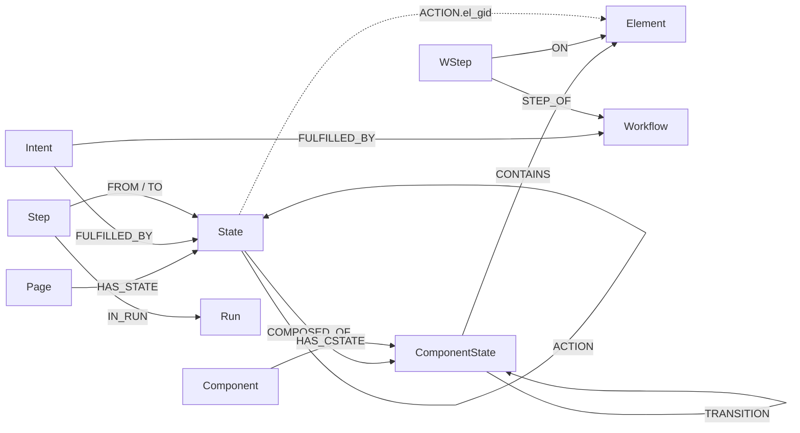

# SiteGraph

SiteGraph is a Python agent system that explores a public website into a **FalkorDB graph**, then uses graph algorithms to plan routes, recommend automations, run them (and keep them working when the UI changes), and turn paths in the graph into demos (video, GIF, screenshot, step guide, click-through).

**Hackathon tracks:** T1 *Agents That Act on Connected Data* (primary) and T2 *Agent Memory & Coordination*:
- **Coordination:** several explorers each work on their own branch of the graph, take work from one shared queue, and are merged by the Curator, with a commit history and `blame` for every change.
- **Memory:** limited. The user's memories, preferences and session summaries are kept and shown to the chat agent, but little is learned automatically. See [Known limits](#known-limits).

> **Status:**
> - **Built and tested with scripted models:** the engine, the graph with git-style history, the agents and the MCP server.
> - **Run live** on books.toscrape.com and the-internet.herokuapp.com: through the command line, through MCP with Claude as the agent, and with a small local model.
> - **The web console lives in a separate repository** (`BrowserAgent-Frontend`, a WebSocket bridge that imports this package). This repository has no web server.

## Demo video

_To be recorded._

## Quick start

Requires Docker, Python 3.11 and [uv](https://docs.astral.sh/uv/).

```bash
docker compose up -d                      # FalkorDB 4.22.1 on localhost:6379 (data in ./data/falkordb); 6.x is not supported yet
uv venv --python 3.11 .venv && source .venv/bin/activate     # Windows Git Bash: . .venv/Scripts/activate
uv pip install -e ".[dev]"
python -m playwright install chromium

# Optional: a model for summaries, intents, captions, request routing and the agents (any LiteLLM model)
cp .env.example .env                      # then set LLM_MODEL and LLM_API_KEY (or LLM_API_BASE for Ollama / a local server)

python -m sitegraph run https://books.toscrape.com/ "explore the site" "open the travel category" "make a gif of the menu"
```

For a conversation instead of a fixed list of requests, use the chat agent (needs an LLM with tool calling and vision; without one it falls back to the fixed request pipeline):

```bash
python -m sitegraph chat https://books.toscrape.com/     # then type: "take me to the mystery category", "make a gif of the menu", ...
```

The agent uses the same engine through tools (find a screen, plan and run a route, observe/click/hover/fill, explore with several browsers, make a demo, remember a preference). **Risky actions (checkout, delete, posting, links to other sites) are refused by the tools until you answer `y` at the terminal prompt**, and that approval covers that one action only. Page text is shown to the model as untrusted data, and what you type into a form is scrubbed from what is stored. See [Agents and tools](#agents-and-tools).

To use the same tools from an MCP client (Claude Desktop, Claude Code, ...) instead of the built-in chat, run the server over stdio, for example in the client's MCP config:

```json
{ "mcpServers": { "sitegraph": { "command": "python", "args": ["-m", "sitegraph", "mcp", "https://books.toscrape.com/"] } } }
```

Risky actions are then approved through the client's own prompt (MCP elicitation); a client that cannot ask simply gets the refusal.

With `run`, each quoted request is run in order against the same site graph. What the agent does depends on the wording:

| Say something like | It does |
|---|---|
| "explore the site" | launches several Navigators in parallel (`--navigators N`, default `navigators_per_site: 2` in `config.yaml`) that map the site, then the Curator annotates it and runs the graph algorithms |
| "open the cart", "take me to X" | finds the matching screen by meaning, plans a risk-capped route, executes it in a real browser, and heals broken locators |
| "make a gif / video / guide / click-through / screenshot of ..." | interprets the request, builds a storyboard from graph paths, records it and renders the files |
| "what should I automate?" | prints next actions, frontier, suggested workflows and demo candidates |
| "save this as a workflow" | stores the last successful run as a reusable workflow |

Without `LLM_API_KEY` the system still runs with built-in fallbacks (keyword routing, title-based summaries, plain captions). Embeddings use `BAAI/bge-small-en-v1.5` (downloaded once, ~130 MB); `--embedder hash` is an offline, much weaker stand-in for quick tests. Results are printed as JSON, and rendered files go to `data/blobs/`.

Config lives in `config.yaml`; a gitignored `.env` file and then real environment variables (`LLM_MODEL`, `LLM_API_BASE`, `LLM_API_KEY`, `SITEGRAPH_*`) override it. Model calls retry rate limits up to 3 times; a call that still fails falls back to the built-in default and logs a warning.

## The graph

SiteGraph stores a website as a state machine:
- **screens** are nodes;
- **the things a user does to move between screens** (click, hover, submit a form) are edges.

The agent never plans from the live page alone. It plans on this map, then checks the plan in the browser.

### Where the graphs live

All graphs sit in one FalkorDB instance and are named by owner, site and device:

| Graph key | Contents |
|---|---|
| `u:{uid}:site:{domain}:{device}` | **Device graph**: the map of one site on one device type, plus everything learned about it (summaries, workflows, run history, demos). Most of this section is about this graph. |
| `…:{device}@br:{agent}-{8hex}` | **Branch**: a copy of the device graph that one explorer writes to. The Curator merges it back. |
| `…:{device}@tag:{name}`, `…@at:{8hex}` | **Tag**: a named snapshot. **Checkout**: the graph as it was at one commit. |
| `u:{uid}:ops:{domain}` | **Ops graph**: agents, tasks, leases, the shared exploration queue, and the commit history of the site's device graphs. |
| `u:{uid}:profile` | **Profile graph**: one user's preferences, exploration policies, memories, sessions, known sites and references to stored secrets. The secret values themselves live in the OS keyring, never in a graph. |
| `u:{uid}:semantic` | **Semantic graph**: patterns shared across sites and devices. Rebuilt from the device graphs and never edited by hand. |

### The device graph



How to read it:
- The map layer is `Page → State → ComponentState → Element`.
- `ACTION` edges between States are the moves.
- The dotted line is a property, not an edge: every `ACTION` names the `Element` it uses in `el_gid`.
- Intents, workflows and the run log hang off the map.
- Demo nodes are listed below but left out of the diagram.

#### Identity: when two observations are the same node

Every node has a `gid` = prefix + first 16 hex characters of SHA-1 over its identity parts. The same screen seen twice, or by two agents, produces the same gid, so writes are idempotent `MERGE`s.

| Node | Identity parts |
|---|---|
| `Page` | domain + **URL template**: the path with id-like segments (numbers, UUIDs, long hex strings, slugs, `name_123`) replaced by `:id`, plus the sorted query-string *keys* (values dropped). `/catalogue/a-light-in-the-attic_1000/index.html` → `/catalogue/:id/index.html`. |
| `Component` | role of the region + its accessible name + its generic CSS path. Whole-page and `main` regions use the URL template instead. |
| `ComponentState` | the component + a hash of its elements' `role\|name` keys. |
| `State` | the page + the sorted list of its *persistent* component states. Menus, tooltips, tab panels and alerts are ephemeral and do not count, so opening a menu does not create a new screen. |
| `Element` | the component + role + key (the link's URL template, else its normalised name) + its index among identical siblings. |
| `ACTION` | source State + Element + action type + input variable name + target State. |

Three refinements keep the map small:
- **Repeated lists** (4 or more items with the same structure and the same link pattern) become one *template* Element. It keeps the item count and up to 60 sample texts. "Open the Travel category" therefore uses the same edge as "open Mystery", with the item chosen at run time.
- **Coarse identity** (`state_identity: coarse`): content regions (`main`, lists, feeds, grids, tables, articles) contribute role counts instead of names. A result list whose entries change stays one State.
- **Near-duplicates**: an observation is folded into an existing State of the same page when it has the same modal dialogs open and its tokens are ≥ 85% similar (Jaccard). The new gid is kept in `State.aliases`.

#### Nodes

| Label | Definition | Main properties |
|---|---|---|
| `Site` | The graph's own record. There is one per device graph. | `domain`, `device`, `schema_version`, `algo_version`, `embed_model`, `embed_dim`. A graph built with one embedding model refuses another. |
| `Page` | A URL template: every URL that differs only in ids or query values. | `url_template`, `title`, `example_urls` (≤5), `example_titles` (≤8) |
| `State` | One screen: a page with a particular set of persistent component states, for example the cart with the login dialog open. Routes run from State to State. | `summary`, `emb` (384-d), `aliases`, `tokens`, `untried_count`, `pagerank`, `betweenness`, `harmonic`, `community`, `reachable`, `demo_score`, `phash`, `screenshot_ref`. Labels: `:Entry`, `:Frontier`, `:Blocking`, `:DeadEnd` (see below). |
| `Component` | A region with an ARIA landmark or widget role (navigation, form, dialog, menu, list, …), or the page body. | `kind`, `blocking` (modal dialog), `ephemeral` |
| `ComponentState` | One version of a component's contents, for example a menu `absent` or `open`. | `name`, `skeleton_hash`, `aria_state`, `screenshot_ref` (a crop of the region) |
| `Element` | An interactive control: link, button, field, select, checkbox, … | `role`, `name_sample`, `locators` (role+name, test id, CSS, text; ordered by `locator_hits`), `fingerprint` (role, name, tag, attributes, CSS path, box), `risk`, `risk_cost`, `tried`, `heal_count`, `is_template`, `count`, `sample_items` |
| `Intent` | A user goal in plain words, such as "view shopping cart". It is written when a screen is summarised or a workflow is saved. | `text`, `emb`, `hits` |
| `Feature` | An area of the site: a community of States found by label propagation, with a short name. | `name`, `size`, `medoid_gid`, `emb` |
| `Workflow`, `WStep` | A saved automation and its ordered steps. A step names an `ACTION` and, for typed input, only a variable name. | `name`, `run_count`, `success_rate`, `demo_score`, `pagerank`; `order`, `action_gid`, `value_var` |
| `Run`, `Step`, `Observation` | The activity log. A run is one exploration, automation or demo. A step is one action attempt. An observation is evidence about a step (`heal`, `unexpected_state`, `recovery`, `item_choice`, `curation`, `visual_diff`). The last 100 runs are kept in full. | `kind`, `status`; `ok`, `healed`, `latency_ms`, `screenshot_ref` (failures only); `detail`, `before_ref`, `after_ref` |
| `DemoRequest`, `Storyboard`, `Shot`, `Render` | A demo from request to file. Each shot points to the screen it shows and the step that produced it. | request text, captions, `map_commit`, blob references |

State labels exist because FalkorDB's algorithms filter by label, not by property:
- `:Entry` is the start page.
- `:Frontier` has elements within the risk limit that were never tried.
- `:Blocking` has a modal dialog open.
- `:DeadEnd` has no outgoing `ACTION`.

#### Relationships

| Type | From → To | Meaning | Properties |
|---|---|---|---|
| `ACTION` | State → State | Using element `el_gid` on the source screen leads to the target screen. | `action_type` (click, hover, select, check, press), `el_gid`, `label`, `risk`, `risk_cost`, `seen_count`, `success_count`, `reliability`, `cost`, `pre_cstates` (menus that must be open first), `pre_actions` (steps learned from earlier recoveries, such as closing a banner), `requires_inputs` (fields filled before the action) and `value_var` (the *name* of the typed value, never the value), `first_seen`, `last_seen` |
| `TRANSITION` | ComponentState → ComponentState | An element changes one region without changing the screen, for example a hover that opens a menu. | `el_gid`, `action_type`, `reliability` |
| `BROKEN_ACTION`, `BROKEN_TRANSITION` | as above | A quarantined edge. It keeps all its properties, but it has a different type, so routing and algorithms no longer see it. | `reason`, `broken_since`, `superseded_by` |
| `HAS_STATE` | Page → State | The screens of a page. | |
| `HAS_CSTATE` | Component → ComponentState | The versions of a region. | |
| `COMPOSED_OF` | State → ComponentState | Which region versions make up a screen. | |
| `CONTAINS` | ComponentState → Element | The controls visible in that version. | |
| `FULFILLED_BY` | Intent → State / Workflow | This screen or workflow satisfies the goal. | `score` |
| `STEP_OF`, `ON`, `FROM` | WStep → Workflow / Element / State | A workflow step: its workflow, element and starting screen. | |
| `CALLS` | WStep → Workflow | A step that runs another workflow (composition, up to 3 levels deep). | |
| `FOLLOWED_BY` | Workflow → Workflow | The second workflow was run within 30 minutes after the first. | `count` |
| `SIMILAR_TO` | Workflow → Workflow | Similar purpose (embedding similarity ≥ 0.8). | `score` |
| `IN_RUN`, `NEXT`, `FROM`, `TO`, `EXECUTED` | Step → Run / Step / State; Run → Workflow | The order of the attempts, where each started and where it really landed. | |
| `DURING`, `OF` | Observation → Step / Element | What an observation is about. | |
| `PRODUCED`, `BASED_ON`, `IN_STORYBOARD`, `SHOWS`, `FROM_STEP`, `RENDERED_AS` | demo nodes | Demo provenance. | |

How an `ACTION` is scored:
- **Reliability:** `reliability = (success_count + 1) / (seen_count + 2)`. A new edge starts at 0.5 and moves with evidence.
- **Cost:** `cost = 1 + 2 · (−ln reliability)`, so a flaky edge is expensive.
- **Risk:** `risk_cost` comes from the element's risk class: 0 read / navigate / input, 1 safe submit, 100 changes data (buy, post, sign up), 1000 leaves the site, 10000 destructive (delete, cancel).

#### The other graphs, in short

- **Ops**:
  - **Coordination:** `Agent`, `Task` (`SUBTASK_OF`, `DEPENDS_ON`), `Claim`, a lease `HELD_BY` an agent, and `WorkItem`, the shared exploration queue. A work item is one page to scan or one click / hover path to try.
  - **History:** `Branch`, `Commit` (`PARENT`, `AUTHORED_BY`), `Change` (`HAS_CHANGE`) and `Tag`. Every change to a device graph is a recorded operation that can be replayed into a merge or reverted.
- **Profile:** `Preference`, `ExplorationPolicy` (risk limit, depth, budget, denied patterns, per site), `Memory`, `Session` and `Request`, `SiteEntry`, `VaultRef`.
- **Semantic:**
  - `UIPattern`: a kind of region seen on several sites.
  - `LogicalState`: the same screen on different devices.
  - `StepPattern` and `FlowPattern`.
  
  They are linked to the device graphs through `SiteRef`, `ComponentRef`, `DeviceStateRef` and `WorkflowRef`. The `DEVICE_DELTA` edge records how many extra steps a screen takes on a phone.

### How the agent queries the graph

Each question the agent asks is one query. Simplified versions follow; the full code is in `src/sitegraph/graph/queries.py` unless noted.

**Which screen does the user mean?** `find_targets`, three steps:
1. A list item named in the request ("Travel") leads to the shared screen behind that list.
2. A vector search over intents.
3. A vector search over screen and workflow summaries.

```cypher
CALL db.idx.vector.queryNodes('Intent', 'emb', $k, vecf32($request_vector)) YIELD node
MATCH (node)-[f:FULFILLED_BY]->(target)
RETURN labels(target)[0], target.gid, coalesce(target.summary, target.name), f.score
```

**How do I get there safely?** `best_routes`. This is the cheapest path over `ACTION` edges whose total `risk_cost` stays under the policy's limit. The path *is* the automation script, and its steps are the explanation shown to the user.

```cypher
MATCH (s:State {gid:$from}), (t:State {gid:$to})
CALL algo.SPpaths({sourceNode: s, targetNode: t, relTypes: ['ACTION'],
                   weightProp: 'cost', costProp: 'risk_cost', maxCost: $max_risk, pathCount: 3})
YIELD path, pathWeight
RETURN path ORDER BY pathWeight
```

**What can I do from here?** `next_actions` lists moves from the current screen, ordered by how often they were seen and how reliable they are.

```cypher
MATCH (s:State {gid:$here})-[a:ACTION]->(t:State) WHERE a.risk_cost <= $max_risk
RETURN a.label, t.summary, a.seen_count * a.reliability AS score ORDER BY score DESC LIMIT 5
```

**What is still unexplored?** `frontier_states` returns screens reachable from the entry that still have untried elements, the most central first.

```cypher
MATCH (e:State:Entry) CALL algo.bfs(e, 8, 'ACTION') YIELD nodes
UNWIND nodes + [e] AS n WITH DISTINCT n WHERE n:Frontier
RETURN n.gid, n.untried_count, n.harmonic ORDER BY n.untried_count DESC, n.harmonic DESC
```

Explorers do not read this list directly. They take `WorkItem`s from the ops graph, highest priority first, and claim each with an expiring lease, so two explorers never do the same work (`ops.py`).

**The stored element is gone. What else could it be?** `fulltext_elements` is the cheapest healing fallback before fingerprint, embedding and model matching. It finds other known elements with a matching name, and never a riskier one than the original.

```cypher
CALL db.idx.fulltext.queryNodes('Element', $name_words) YIELD node
WHERE node.role = $role AND node.risk_cost <= $original_risk_cost
RETURN node.gid
```

**What breaks if this region changes?** `impact_of_component` lists the workflows and demos that use the region's elements.

```cypher
MATCH (c:Component {gid:$region})-[:HAS_CSTATE]->(:ComponentState)-[:CONTAINS]->(e:Element)
MATCH (ws:WStep)-[:ON]->(e), (ws)-[:STEP_OF]->(w:Workflow)
OPTIONAL MATCH (sb:Storyboard)-[:BASED_ON]->(w)
RETURN e.name_sample, collect(DISTINCT w.name), collect(DISTINCT sb.title)
```

**Who discovered this, and when?** `GitOps.blame` in `git.py` runs on the ops graph. It feeds the "discovered by explorer-desktop-0 in c:1ba9…" line in route explanations.

```cypher
MATCH (c:Commit)-[h:HAS_CHANGE]->(x:Change) WHERE x.touched CONTAINS $gid
OPTIONAL MATCH (c)-[:AUTHORED_BY]->(a:Agent)
RETURN c.id, c.msg, a.id, x.op ORDER BY c.ts
```

**Precomputed by the Curator** (`agents/curator.py`) after every exploration. The scores are stored on nodes, so the queries above only read a property:

```cypher
CALL algo.pageRank('State', 'ACTION') YIELD node, score SET node.pagerank = score
CALL algo.betweenness({nodeLabels:['State'], relationshipTypes:['ACTION']}) YIELD node, score SET node.betweenness = score
CALL algo.HarmonicCentrality({nodeLabels:['State'], relationshipTypes:['ACTION']}) YIELD node, score SET node.harmonic = score
CALL algo.labelPropagation({nodeLabels:['State'], relationshipTypes:['ACTION']}) YIELD node, communityId SET node.community = communityId
CALL algo.WCC({nodeLabels:['State'], relationshipTypes:['ACTION']})  // which screens the entry can reach
MATCH (s:State) WHERE NOT (s)-[:ACTION]->() SET s:DeadEnd
```

| Score | What it is used for |
|---|---|
| PageRank, betweenness | Which screens are worth a demo (`demo_score`) |
| Harmonic centrality | Which unexplored screen to try first |
| Communities | The site's `Feature` areas |
| Reachability | Screens that no longer connect to the entry |

**Writing an observed move** (`graph/map_writer.py`). Each attempt updates the counters, then the reliability and cost:

```cypher
MERGE (a)-[r:ACTION {gid:$g}]->(b)
SET r.seen_count = coalesce(r.seen_count, 0) + 1, r.success_count = coalesce(r.success_count, 0) + $ok
WITH r SET r.reliability = toFloat(r.success_count + 1) / (r.seen_count + 2)
WITH r SET r.cost = 1.0 + $lambda * (0.0 - log(r.reliability))
```

The `WITH r` barriers are needed: in FalkorDB, a `SET` does not see a value written by an earlier `SET` on the same entity in the same clause.

## Agents and tools

The deterministic engine stays the fast, cheap, no-LLM path. LLM agents sit on top of it and take over where judgement is needed. Everything goes through one **tool layer** (`src/sitegraph/tools/`), which is where safety is enforced, so no agent can bypass it.

| Component | What it is | LLM agent |
|---|---|---|
| **Execution agent** (`chat`) | You ask for things in plain language; it calls tools (find screens, plan/run routes, observe/click/hover/fill, explore, demos, memory) | Full agent |
| **Navigator** | Explorer and executor. It heals stale locators itself and replays steps learned from earlier recoveries. With a model it can explore *guided*: the model picks which group of unexplored links to follow next | Escalates to a **recovery agent** when stuck (cookie wall, blocking overlay, element gone): it gets the goal, the failed step, the page, a screenshot and what was tried, with a restricted browser toolbox |
| **Curator** | Algorithms, summaries, features, retention | Escalates to a **review agent** for anomalies it cannot settle by rule (near-duplicate states, clashing names, state explosion, failing actions); it may merge states, rename/re-summarise and quarantine or restore actions, each edit with a logged reason |
| **Demo Director** | Records and renders demos | Full **Demo agent**: chooses shots, records them one by one, looks at previews and retakes bad ones, writes captions, renders video / GIF / screenshot / guide / click-through, and may ask you a question. The fixed pipeline remains the fallback with no LLM |
| **Orchestrator** | Turns a request into tasks for the other components | With a model it:<br>- splits a request into steps;<br>- profiles a new site before exploring it (from robots.txt, the sitemap and the entry page);<br>- chooses between brute-force and guided exploration;<br>- searches toward a screen the map does not have yet;<br>- checks the result: a *verify* step must quote evidence that is really on the page. |

Safety model (all inside the tools):
- Every browser action is checked against the active exploration policy; above the allowed risk level it needs your one-time approval for that exact action (terminal prompt, or MCP elicitation). Approvals are never granted by a model.
- Page and site text is passed to models marked as untrusted data, trimmed in length.
- Typed values are never stored: `fill` remembers only a variable name, the value is scrubbed from URLs, titles and names before anything is written, and `Toolbox.redacted` hides it from logs and traces.
- Sensitive fields are never filled from a request or by a model. That means passwords, email, phone, payment, address and personal-name fields, recognised by input type, autocomplete hint or name. A stored secret can be typed with `fill(from_secret=...)` without its value reaching the model.
- Memory (`remember` / `recall` / `list_memories` / `forget`) refuses passwords, keys, emails and long numbers, and you can review and delete what is saved.
- Limits per request (configurable): 60 model turns, ~400k tokens, 5 recovery attempts per run, 20 curator edits per review.
- A model that cannot call tools, or no model at all, disables the agents and the fixed pipeline runs instead.

## Data use

Only public, unauthenticated pages are explored. Typed input values are never stored in any graph, log or blob (only variable names). Exploration skips risky elements (checkout, delete, external links) and respects `robots.txt`. Good demo sites: `books.toscrape.com` and `quotes.toscrape.com` (built for scraping practice).

## AI assistance disclosure

Built with Claude Code (Anthropic) as a coding assistant; the graph model, queries and architecture were designed and reviewed by the author.

## Tests

```bash
pytest -m "not slow"     # skips video/GIF recording
pytest                   # full suite; needs Docker (FalkorDB) and Chromium; about 30 minutes; never reads .env
pytest -m llm            # live-model test; set LLM_MODEL and LLM_API_KEY (or LLM_API_BASE) in the environment, skipped otherwise
```

Integration and browser tests are skipped (not failed) when FalkorDB is not running, so check the pass/skip counts.

## Known limits

- **Limited live testing.** Runs on real sites so far are books.toscrape.com and the-internet.herokuapp.com, with Claude (through MCP) and a small local model. The vision features have not been tried with a real vision model.
- **Some browser actions are missing:** drag and drop, sliders, touch gestures, file uploads and lists that remove entries as you scroll.
- **Public pages only.** Pages behind a login are skipped.
- **Exploration is slow on large sites:** every path is replayed from a fresh page load.
- **Late-appearing elements** (timers, banners) are explored only on a later run.
- **No approvals during recovery.** If getting past an obstacle needs your approval, the step fails instead of asking you.
- **Memory is basic.** It keeps what you ask it to remember and summarises each chat session, but learns little on its own.
- **Weaker without a model.** Requests are matched by keywords, so they must name what they want.
- **Setup:**
  - FalkorDB must be version 4.22.1.
  - On Windows, if the visible browser does not start, set `SITEGRAPH_BROWSER_CHANNEL=chrome`.
  - The web console is a separate project; this repository has no web server.
